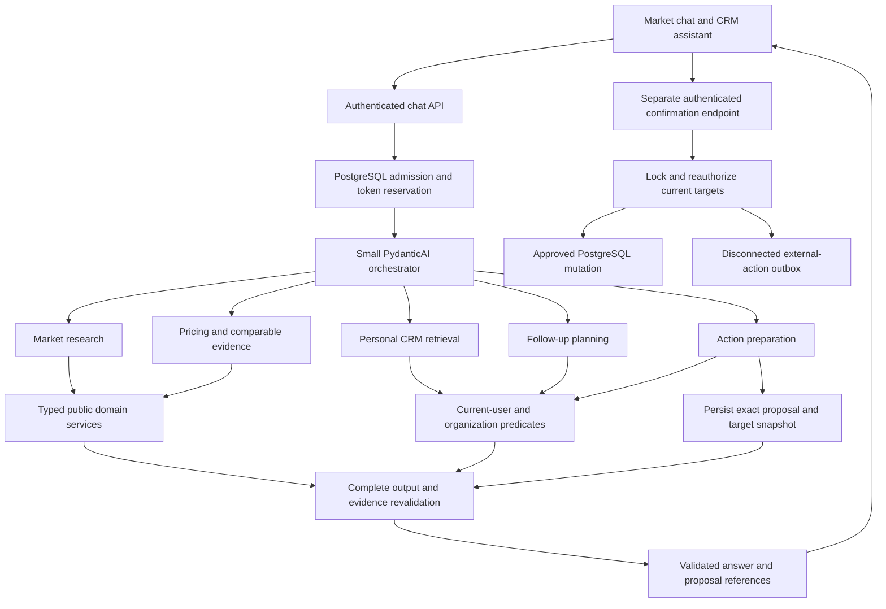

# AI assistant architecture and engineering handoff

Implementation snapshot: 2026-10-31. This describes the repository implementation, not a production deployment or security certification. The application database has **not** been migrated by this work; migration verification used disposable test databases. Live model trials remain pending because the evaluation credential expired. No trial winner was selected, the configured production model was not changed, and no real messages, invitations or listings were sent or published.

Read this alongside [development.md](../development.md) and the [production architecture reference](../production-readiness-2026-09-29.md). The initial deployment target remains one enterprise of approximately 150 users.

## Runtime and capability graph

The existing PydanticAI runtime provides typed tool arguments, dependency injection, nested agent execution and shared usage accounting. The main agent routes requests to five focused workflows instead of owning a large collection of database and mutation tools. Every workflow receives the same authenticated user, organization, conversation and turn-local evidence/budget objects.



[agent.py](../backend/app/chat/agent.py) registers the five routing tools. [workflows.py](../backend/app/chat/workflows.py) defines their specialist toolsets. The orchestrator has no arbitrary SQL, shell, HTTP or execution tool. The action agent can propose changes and resolve a colleague's business name; it cannot call confirmation or execution.

| Capability | Implementation and current lifecycle |
| --- | --- |
| Market statistics, dates and coverage | Existing analytics services supply calendar periods, definitions, counts and source coverage. Unknown or unverified evidence is distinguished from a verified zero. |
| Listing shortlists and age | Bounded listing pages use exact filters before counting/pagination. Age is measured at the actual capture timestamp. Missing timestamps mean unknown age; availability must be verified before acting. |
| Registered comparables, appraisal and yield | Canonical sales/rental filters return an exact matching count plus a bounded recent sample. Backend arithmetic supplies median/IQR, indicative value and gross yield. Fewer than five matches produces no appraisal/yield estimate. |
| Project comparison | Up to three exact catalogue projects expose stored unit prices/sizes, payment steps, construction progress and scheduled delivery. Ambiguous names return candidates; missing fields remain missing. Assets and brochures are excluded. |
| Personal CRM and text retrieval | Own leads, imported claims, saved records, workspaces, authored notes/activities, reminders, viewings and drafts. Literal bounded text search; no vector database or embeddings service. |
| Renewal research | Only currently accessible opened inbound renewal leads. A selected record can retrieve current lease evidence without shared owner enrichment or a matching refresh. |
| Follow-up planning | Fresh CRM reads support plans and conversational message drafts. A plan or draft does not send anything. |
| Approved internal writes | Lead create/update/assign/delete, adding an own note, reminder create/update/delete, internal viewing schedule/cancel, listing draft create/update. Every operation requires a persisted proposal and separate application confirmation. |
| External messaging, publication and booking | Proposals and disconnected outbox state exist. No live adapter or dispatcher is configured. Confirmation reports `not_connected`; it does not imply delivery. |
| Files, exports, secrets and raw dumps | No document/file generation or download tools. Requests for PDFs, Word files, credentials, SQL/API schemas, bulk contact dumps and raw database dumps are refused or withheld. Numerical aggregates remain supported. |

The main research boundaries live in [chat/tools.py](../backend/app/chat/tools.py), [analytics/assistant.py](../backend/app/analytics/assistant.py), [analytics/market_metric_queries.py](../backend/app/analytics/market_metric_queries.py), [listings/assistant.py](../backend/app/listings/assistant.py) and [project/assistant.py](../backend/app/project/assistant.py). SQL remains in the owning domain. New comparable queries bind user values, restrict periods to two years and samples to twenty rows. Listing research is bounded to twenty rows per page. Project output reports totals when it shows only the first twenty unit types or payment steps.

Indicative appraisals are screening aids, not formal valuations. They do not match condition, floor or view, and gross yield excludes fees, service charges, vacancy and financing. Nearby achieved prices require a separately scoped query; a project name is not proof of geographic equivalence. Reconciled DLD/DXBI counts, DXBI-only profiles and Property Finder asking inventory retain distinct business source labels.

## Identity, shared conversation and retrieval

Both [Market chat](../frontend/src/routes/chat/+page.svelte) and the [CRM assistant](../frontend/src/routes/crm/assistant/+page.svelte) use [conversationSelection.svelte.ts](../frontend/src/lib/chat/conversationSelection.svelte.ts). The selection is scoped to the current user and organization, and is accepted only when present in the authenticated conversation list. They share persisted conversation/history rather than creating unrelated private contexts. Server predicates enforce both user and organization on conversation operations.

[CRM assistant retrieval](../backend/app/crm/assistant_repository.py) enforces current assignment: an inbound enquiry is visible when assigned to the caller, or when unassigned and created by the caller. Imported owner claims require the caller's own import and list in the current organization. Notes and activities require both authorship and a currently accessible parent. Linked reminders/viewings do not preserve access to a reassigned lead. Organization owners receive no master rights to colleagues' private CRM records. Deals and shared matching are explicitly unavailable to this assistant.

Membership and active/trialing organization subscription are rechecked for private retrieval and before private history/final delivery. Scalar authorization reads avoid trusting stale ORM membership state. Colleague lookup is a narrowly scoped organization-name lookup for assignment, not access to another agent's CRM: it returns at most ten current matches, requires clarification for ambiguous names, and rejects guessing when the directory is unavailable.

History reads return the newest hundred messages in chronological order and support `before_id` pagination. Private answers store server-side query fingerprints and resource references. History retrieval and final delivery reauthorize evidence and proposal targets; changed/revoked evidence causes the entire associated answer, including artifacts, to be withheld. Legacy assistant history without the new evidence/guardrail metadata fails closed.

Private prose and historical user quotations are not replayed as fresh evidence. For follow-ups, the server may retain at most twenty independently reauthorized resource/record handles from the latest relevant answer. A still-owned record can retain its lookup handle after an edit while its stale prose is withheld; reassignment/deletion removes the handle. The model must retrieve facts again, and must ask for clarification if multiple handles could be meant. These internal handles are excluded from the public history response. See [chat/service.py](../backend/app/chat/service.py) and [chat/agent.py](../backend/app/chat/agent.py).

## Exact approval and execution boundary

[assistant_actions/models.py](../backend/app/assistant_actions/models.py) defines strict payloads per action kind. The model supplies proposed business fields; the server supplies actor, organization and conversation identity. A text claim of approval never executes an action.

1. The service authorizes current membership, subscription, conversation and target ownership, then locks the target records and captures their versioned snapshot.
2. It persists the exact payload, request hash, readable target/changes preview, scoped idempotency key and a fifteen-minute expiry.
3. Chat emits only a proposal reference/current authorized preview. [ChatActionCard.svelte](../frontend/src/lib/components/chat/ChatActionCard.svelte) retrieves the persisted action and presents confirmation/cancellation.
4. `POST /api/v1/assistant/actions/{action_id}/confirm` accepts the action ID, not replacement fields. The service reloads the persisted request, rechecks its hash, permissions and target snapshot, and rejects changed arguments or stale targets.
5. An internal mutation runs within the transaction/savepoint and stores its outcome. Repeated confirmation returns the existing outcome without repeating the mutation. Cancelled, expired, failed or already completed proposals do not execute again.

Readable target names/details are part of the protected preview, not permanent permission to a former target. Final chat delivery refreshes even proposal-only turns and suppresses prose/proposals when the target is inaccessible or the canonical status is no longer `awaiting_confirmation`. History and action-list responses also redact revoked target details.

Lead deletion refuses shared or colleague-authored dependent work and preserves the shared contact. Updating a lead cannot arbitrarily rewrite identity or shared contact fields. Assignment targets must still belong to the same organization. Business operations are allowlisted; there is no generic entity mutation endpoint. Implementation: [service.py](../backend/app/assistant_actions/service.py), [repository.py](../backend/app/assistant_actions/repository.py), [router.py](../backend/app/assistant_actions/router.py).

Reminders are persisted personal records without notification delivery. Viewings are internal records without calendar invitations. Listing drafts are private drafts without publication. [adapters.py](../backend/app/assistant_actions/adapters.py) defines a dormant typed external boundary: a future dispatcher must reauthorize and claim an outbox item before one bounded attempt, use the proposal ID as provider idempotency key, and treat ambiguous outcomes as `unknown` requiring reconciliation. Automatic retries after uncertain delivery could duplicate a send. No live provider entrypoint is installed.

## Output, budgets and provider policy

[security.py](../backend/app/chat/security.py) and [crm_tools.py](../backend/app/chat/crm_tools.py) supplement repository authorization and narrow toolsets:

- Input is bounded to 8,000 characters; final output to 16,000; a tool response to 24,000 serialized characters. Tool DTOs exclude technical metadata, credentials, raw errors and unneeded contacts/assets. Oversized record/series collections fail with an explicit narrowing response instead of silently claiming completeness. Long retained source text is marked truncated.
- A cumulative ten-row CRM detail budget is shared by all specialists in a turn. Counts and numerical aggregate summaries remain available independently. Recognizable structured/contact dumps are checked at input/output boundaries. These checks are supplementary defenses, not a complete prompt-injection classifier or DLP guarantee.
- The complete model answer is buffered, checked and reauthorized before persistence or content SSE. No partial model text is emitted before this check. Unsafe links/download workarounds and recognizable internal/secret output are withheld. Logs expose exception types rather than raw exception parameters.
- All nested agents share a `RunUsage`: sixteen model requests, twenty-four tool calls, a 24,000-token limit and a 300-second turn deadline. Each model response requests at most 3,000 output tokens. A final provider response can overshoot a measured usage limit; these are not hard dollar caps.

[admission.py](../backend/app/chat/admission.py) adds PostgreSQL-backed admission across workers: one active turn per user, one per conversation, and twenty per organization. Transaction advisory locks serialize reservation decisions in a fixed order; database connections are released during provider latency. A 600-second lease exceeds the 300-second execution deadline. Before a model call, the system reserves 24,000 tokens against the authenticated user's daily allowance. There is no unbounded queue of provider work.

A completed provider run settles actual usage and refunds unused reservation once. Failure, cancellation, an expired run or missing completion accounting conservatively retains at least the reservation; observed overruns are charged too. Lease expiry frees concurrency capacity, not token credit. Settlement uses a separate transaction, and daily usage changes use PostgreSQL atomic upserts to avoid lost increments. See [token_usage/repository.py](../backend/app/token_usage/repository.py).

Provider requests specify OpenRouter `zdr: true` and `data_collection: deny`. This is a request policy, not proof of every provider's retention, residency or contractual behavior. Approved provider endpoints, contractual/privacy review and real credential validation remain rollout gates. Telemetry's [AllowlistExporter boundary](../backend/app/core/observability.py) is the sole configured remote trace path. [Application initialization](../backend/app/main.py) disables default Logfire remote export, disables agent instrumentation when no approved custom provider exists, and has no fallback FastAPI instrumentation. The [PostgreSQL engine](../backend/app/postgres/client.py) also enables `hide_parameters=True`. Initialization tests cover these boundaries with a synthetic telemetry token. Provider flags alone do not address legacy instrumentation leaks, and these controls do not eliminate vulnerable dependency risk.

## Migrations and rollout

[8a4c1e6b0d93](../backend/migrations/versions/8a4c1e6b0d93_assistant_actions.py) creates proposals, personal reminders/viewings/drafts and the outbox. Its successor [9b5d2f7a1e04](../backend/migrations/versions/9b5d2f7a1e04_chat_admission.py) adds durable turn leases and the unique daily usage ledger.

The new ledger is initialized by summing legacy usage rows per user/day. Original `user_token_usage` rows are preserved unchanged. **Pause AI writes during the ledger cutover:** old binaries continue writing the legacy table and must not do so after its totals have been copied. Apply migrations with the deployment's migrator, move all usage writers to the new version, verify accounting, then resume. The admission migration intentionally refuses automatic downgrade; post-cutover charges need operator-reviewed reconciliation before returning to old binaries. Do not drop either ledger as a rollback shortcut.

This work exercised migrations only against disposable PostgreSQL databases. The local application database and production were not migrated or deployed. Production deployment still requires the operational gates in the production reference, backups, monitoring and verification with approved credentials.

The dependency audit remains open: the recorded backend snapshot contains **293 advisory entries affecting 35 packages**; entries can duplicate vulnerability identifiers and are not 293 unique CVEs. The frontend snapshot reports **30 affected packages after DOMPurify 3.4.17**. Remediation and refreshed audits remain necessary. These changes do not establish penetration-test completion, ASVS compliance or a security certification. The expanded Bandit scan covered 29 files and completed without scanner errors, with two reviewed warnings: B104 (medium) for the existing `0.0.0.0` Uvicorn bind in `main.py`, whose exposure depends on deployment network policy; and B112 (low) for the intentional exception/continue path that drops inaccessible or failed follow-up handles in `chat/service.py`. This is not a zero-finding security scan.

## Verification and follow-up

Tests use `FunctionModel`/`TestModel`, disposable PostgreSQL and disposable ClickHouse; they do not require live model calls. Coverage includes wrong-user/org access, reassignment, revoked membership/subscription, stale previews, duplicate/concurrent confirmation, destructive safeguards, zero-evidence proposal revocation, private history, capture-age filtering, exact comparable aggregates, prompt/output boundaries, shared limits and cross-worker admission/accounting. UI tests cover action rendering/confirmation and shared chat behavior.

Run canonical commands from the repository root with the supported Node/Bun tools on `PATH`:

```sh
just test-backend
just test-backend-postgres
just test-backend-clickhouse
just lint-backend
just lint-frontend
just check-frontend
just test-frontend
just build-frontend
just test-e2e e2e/chat.spec.ts
```

Useful focused suites include [chat security](../backend/tests/unit/test_chat_security.py), [workflow research](../backend/tests/unit/test_chat_workflow_research.py), [private history/renewals](../backend/tests/integration/postgres/test_chat_workflow_security.py), [admission](../backend/tests/integration/postgres/test_chat_admission.py), [action persistence](../backend/tests/integration/postgres/test_assistant_actions_persistence.py), [warehouse capabilities](../backend/tests/integration/clickhouse/test_chat_capabilities.py), and [browser chat](../e2e/chat.spec.ts). Final verified results for this snapshot:

| Check | Result |
| --- | --- |
| Full offline backend | 1,544 passed, no skips |
| Full disposable PostgreSQL | 74 passed |
| Full disposable ClickHouse | 103 passed |
| Frontend unit tests | 309 passed |
| Mocked browser tests | 10 passed |
| Frontend lint | 349 files passed |
| Svelte checks | Zero errors and zero warnings |
| Frontend production build | Passed |
| Backend Ruff code lint / assistant-owned formatting | Passed |
| Independent final review | PASS: 114 focused offline, 35 PostgreSQL and 25 ClickHouse checks; no remaining gaps identified within the implemented scope |

The initial repository-wide backend formatting check was blocked by three pre-existing baseline files: [owner-recovery CLI](../backend/scripts/crm/owner_recovery_experiment/cli.py), [namespace delivery](../backend/scripts/crm/owner_recovery_experiment/namespace_delivery.py), and [owner-recovery handoff tests](../backend/tests/unit/test_owner_recovery_handoff.py). The subsequent publication check formatted these files and passed `just check-all`; see the [production decision handoff](ai-assistant-production-review.md) for the current verification record. The reviewed Bandit warnings and dependency advisories above remain open; passing tests do not turn them into security clearance.

Astra builders implemented the changes, Sol performed independent verification, and Luna scouts supplied reconnaissance; no model-role fallback was used.

[model_trial.py](../backend/scripts/evaluation/model_trial.py) screens a selected focused specialist with every tool replaced by synthetic implementations; orchestrator routing has separate offline acceptance tests. [benchmark.json](../backend/scripts/evaluation/benchmark.json) retains canonical business questions. The requested four-model live comparison is pending the expired credential: no live rerun, winning model or quality claim is implied by offline success.

Deployment must configure finite reverse-proxy/load-balancer SSE idle and request timeouts consistent with the 300-second execution deadline and admission window. Answers are buffered and the stream currently has no heartbeat, so an idle timeout shorter than provider work can terminate a valid turn. Proxy timeout/heartbeat deployment changes were not implemented here; test disconnect and cancellation behavior in the deployed path.

Measure before expanding this design. Investigate action-lock contention, bounded retrieval latency and authorization-aware caching with realistic tenant sizes; measure the model budget on canonical workflows before changing it. Assess provider adapters one at a time with reconciliation tests before connecting external delivery. Adopt vector retrieval only if measured retrieval failures justify its operational and authorization costs.

## Design references

These references guided the boundaries; they are not claims of conformance:

- [OWASP ASVS 5.0](https://asvs.owasp.org/) supplies an application-security verification framework. Use versioned requirements when building a separate assessment.
- [OWASP API1:2023 object-level authorization](https://api-security.owasp.org/editions/2023/en/0xa1-broken-object-level-authorization/) informs checking every requested target instead of trusting IDs or role claims; [API4:2023 resource consumption](https://api-security.owasp.org/editions/2023/en/0xa4-unrestricted-resource-consumption/) informs bounded admission, input/output sizes and usage budgets.
- [OWASP Excessive Agency guidance, 2025 edition](https://genai.owasp.org/llmrisk/llm062025-excessive-agency/) and [Agentic Applications Top 10, 2026](https://genai.owasp.org/resource/owasp-top-10-for-agentic-applications-for-2026/) inform least-privilege tools, untrusted retrieved content and application-enforced action approval. The dated Excessive Agency reference is explicit because risk numbering changes between editions.
- [PydanticAI deferred tools](https://pydantic.dev/docs/ai/tools-toolsets/deferred-tools/) documents approval/deferred execution patterns. This application reuses installed PydanticAI for typed workflows and implements durable approval in its own PostgreSQL action service; it does not claim to use native `DeferredToolRequests`. Adding another orchestration framework would not supply the missing domain authorization, durable preview or accounting rules.

## Planned first three connectors: mail, calendar and WhatsApp

**Plan only, researched 2026-10-31.** No connector, route, table, configuration, migration or verification result below is implemented by this extension. Existing disconnected behavior and test results above remain unchanged. These are application integrations, independent of Codex plugins. Shared mailboxes and direct listing-portal publication are deferred.

### Enrollment and ownership

Current [/setup](../frontend/src/routes/setup/+page.svelte) collects profile/organization details and starts checkout; [/setup/complete](../frontend/src/routes/setup/complete/+page.svelte) activates billing, offers invitations and redirects to the dashboard. Plan an optional connections step **after authenticated organization membership and entitlement activation**, also available to invited agents and later through a planned `/settings/connections` route. Skipping connections must preserve application access. Signup/session authentication stays independent; never collect mailbox passwords.

Each agent owns three separately consented capabilities: mail ingestion, calendar availability/booking, and their business-number WhatsApp conversations. Gmail/Google Calendar or Outlook/Microsoft Calendar may share one provider account, with per-capability actual scopes/status so partial consent works. Distinguish OAuth connected status from initial-sync completion. The company assistant number is organization-owned infrastructure, not authority over every mailbox or private CRM. Organization owners gain no colleague-mail or CRM access.

Plan one `backend/app/connectors` domain with `models.py`, `repository.py`, `service.py`, thin `router.py`, provider adapters and a worker entrypoint. Planned API operations cover start/callback, status, disconnect, calendar selection, phone linking and provider webhooks. Regenerate typed frontend APIs and query builders when these contracts are implemented. A serial migration after the then-current Alembic head should add only needed records: connections/grants, expiring authorization/link attempts, channel bindings, webhook inbox/jobs, sync cursors and intake candidates. Reuse existing proposals/outbox for writes.

Bind OAuth state and PKCE to authenticated actor, organization and provider; make attempts single-use with a short TTL. Verify callback identity using immutable provider subject/account identifiers, never an editable email address. Persist actual granted scopes. Encrypt backend-only grants with KMS envelope encryption and managed keys, separate from `SESSION_SECRET`; exclude tokens/content from logs and browser responses. Serialize refresh-token rotation and bounded retries. Disconnect, scope reduction and offboarding invalidate pending work, stop subscriptions, revoke/remove grants as supported and recheck live identity/permissions before every job. [OAuth practices](https://developers.google.com/identity/protocols/oauth2/resources/best-practices).

### Inbound evidence and private CRM

Use a durable PostgreSQL webhook inbox and leased jobs with provider-event deduplication, cursors and reconciliation. Webhook HTTP handlers authenticate, bound and persist payloads, then acknowledge; parsing/model work runs in workers. Initially use bounded scheduled Gmail API polling through PostgreSQL jobs/cursors, consistent with Phase 1 simplicity. Gmail push is optional later and requires Pub/Sub only if enabled; it would transport notifications, not replace PostgreSQL jobs.

If Gmail push is enabled, validate Google Pub/Sub JWT issuer, signature, audience and configured subscription-to-connection mapping. For Graph, distinguish initial challenge validation from subsequent POST authentication: verify secret `clientState` plus subscription/resource binding; rich notifications require their additional validation/decryption. Meta POST verification uses raw-body HMAC with the app secret; GET challenge verification alone is insufficient. Signatures do not prevent replay: deduplicate scoped message/event IDs. [Google authentication](https://cloud.google.com/pubsub/docs/authenticate-push-subscriptions), [Graph delivery](https://learn.microsoft.com/en-us/graph/change-notifications-delivery-webhooks), [Meta signatures](https://whatsapp.github.io/WhatsApp-Nodejs-SDK/api-reference/webhooks/start/).

Mail primarily ingests listing-portal enquiry emails. Start from connection time, without a historical mailbox crawl; restrict intake to agent-selected sources/folders. Bound fetched bytes, MIME nesting and HTML processing; disable attachments and remote-content fetching by default. Treat sender claims, email text and customer WhatsApp content as untrusted evidence, **never agent commands**. A verified webhook proves provider delivery, not sender identity or CRM ownership.

Extract a private candidate with provenance and uncertain fields; agent approval invokes the existing `create_lead` action. Deduplicate intake by connection/message ID, not organization-wide contact lookup. Preserve current-assignment authorization; no shared-contact deduplication or unassigned-agency search. Any later deterministic auto-import requires a separate explicit opt-in rule and evaluation.

### Two distinct WhatsApp channels

The company assistant number accepts agent commands only after a logged-in user completes a one-time phone-possession link. Resolve Meta account, receiving endpoint/purpose, sender link and live user/organization access together. A phone is a revocable contact channel, not login identity. Relinking/offboarding invalidates prior bindings. App and agent-command WhatsApp can share the same authorized private conversation ID, history and admission/token budgets; reauthorize before delivery on either channel.

Each agent's customer messaging number instead uses official Cloud API onboarding/Embedded Signup. Customer threads have distinct IDs and never merge into private assistant history or inherit agent tools. Approval opens the logged-in application and binds the actor to the exact persisted proposal; plain “yes,” forwarded approvals and customer messages cannot execute it.

Business-app coexistence is a specific eligible onboarding flow, not general access to personal WhatsApp accounts. Plan `whatsapp_business_messaging` and `whatsapp_business_management`; confirm any additional signup permissions against the selected flow. Meta App Review, advanced access and number/account eligibility remain deployment gates; current detailed eligibility could not be verified because official developer pages returned 429. The older Meta signup collection also names `business_management`; do not copy its scope set without current review. [Meta signup documentation](https://www.postman.com/meta/whatsapp-business-platform/documentation/du6gzjv/embedded-signup), [coexistence reference](https://developers.facebook.com/documentation/business-messaging/whatsapp/embedded-signup/onboarding-business-app-users). Require recipient opt-in, approved templates for initiation/outside the 24-hour service window, opt-out handling and clear escalation paths. [Messaging policy](https://whatsappbusiness.com/policy/).

Cached official terms restrict AI providers when AI is primary rather than ancillary functionality, with regional exceptions. A real-estate-specific label does not establish permission, especially for the assistant-number product. The current terms redirected behind login during research: confirm current applicability and geographic conditions before launch rather than claiming blanket allowance. [Current platform terms](https://www.facebook.com/legal/Meta-Terms-for-WhatsApp-Business-Platform).

### Calendar and outbound execution

Configure conflict calendars and one writable booking calendar; request write consent incrementally before the first booking. Check every selected conflict calendar at proposal **and execution**, independently across Google/Microsoft connections. Unknown availability blocks booking. Normalize explicit user time zones (including `Asia/Dubai`) to UTC; test daylight-saving changes, buffers, tentative/conflict states and duplicate execution. Serialize application reservations, while acknowledging unavoidable races with external writers. Creating a private event and inviting attendees need explicit distinct approval/capabilities; cancellation is limited to authorized events created by this integration.

Provider writes reuse exact proposals and the existing outbox: recheck membership, assignment, destination, connection and scopes; persist a claimed `unknown` attempt before network I/O. Record success only with provider evidence. Separate definite failure from uncertain delivery and reconcile the latter without automatic duplicate sends/bookings. The existing adapter's proposal-ID convention is an application idempotency contract; provider support must be verified separately, never assumed.

Stage-four outbound email uses the existing `SEND_MESSAGE` exact-proposal approval and outbox flow, sending only from the actor-owned connected mailbox. Request send permission incrementally when enabling this capability; initial mail intake remains read-only. Inbound emails never authorize or automatically trigger sending.

### Provider scope and operational gates

| Provider | Planned minimum access and lifecycle |
| --- | --- |
| Gmail | `gmail.readonly` for bodies; metadata is insufficient. Restricted-scope verification and generally annual security assessment for server processing apply unless a documented exception covers deployment. Stage-four approved sending requires incremental `gmail.send` consent. [Scopes](https://developers.google.com/workspace/gmail/api/auth/scopes), [verification](https://developers.google.com/identity/protocols/oauth2/production-readiness/restricted-scope-verification). Start with bounded polling and history reconciliation; if push is enabled, renew watches daily/before seven days and retain reconciliation. [Watch lifecycle](https://developers.google.com/workspace/gmail/api/guides/push). |
| Google Calendar | `calendar.freebusy` for own availability or `calendar.events.freebusy` for accessible calendars; separately request `calendar.events.owned` for owned-calendar writes, broader event access only when needed. Calendar listing requires its own scope. [Scopes](https://developers.google.com/workspace/calendar/api/auth). |
| Microsoft Graph | Delegated `Mail.Read` for bodies; incremental delegated `Mail.Send` consent for stage-four approved sending; `offline_access` for background grants; `Calendars.ReadBasic` for availability, `Calendars.ReadWrite` for booking. Event subscriptions require `Calendars.Read` or sufficient higher access. `getSchedule` excludes personal Microsoft accounts: implement/test a calendar-view alternative before promising support. [Permissions](https://learn.microsoft.com/en-us/graph/permissions-reference), [availability](https://learn.microsoft.com/en-us/graph/api/calendar-getschedule?view=graph-rest-1.0). Outlook subscription maxima: 10,080 minutes, or 1,440 with resource data; renew early and reconcile lifecycle failures. [Subscriptions](https://learn.microsoft.com/en-us/graph/api/resources/subscription?view=graph-rest-1.0). |

Example: a portal email creates an agent-private candidate; the agent reviews and approves a lead in-app, requests a viewing from the linked assistant number, reviews availability and the exact event/invitation proposal in-app, then receives provider-confirmed booking status. Customer replies remain evidence in their separate thread.

Roll out in stages: (1) provider registrations, approved HTTPS callbacks, credentials/key management, consent/privacy and Meta policy gates; (2) connection lifecycle and read-only mail candidates/calendar availability; (3) linked agent WhatsApp, then business-number customer intake without requiring every agent to provision a business endpoint first; (4) explicitly approved provider writes and reconciliation. Keep unavailable capabilities visibly disconnected.

Acceptance must cover forged/replayed callbacks, wrong user/organization, stale phone links, revoked scopes/membership/assignments, disconnect during dispatch, refresh races, malformed/oversized MIME, spoofed portal messages, inbound prompt injection, cross-channel history leakage, duplicate webhooks, cursor gaps, conflicting calendars, DST, expired approvals and crashes after provider acceptance. Use disposable databases and provider test accounts; live sends need separate explicit authorization. Verify onboarding for owners and invitees. No runtime tests were rerun for this documentation-only extension; these cases and all provider provisioning remain outstanding.
