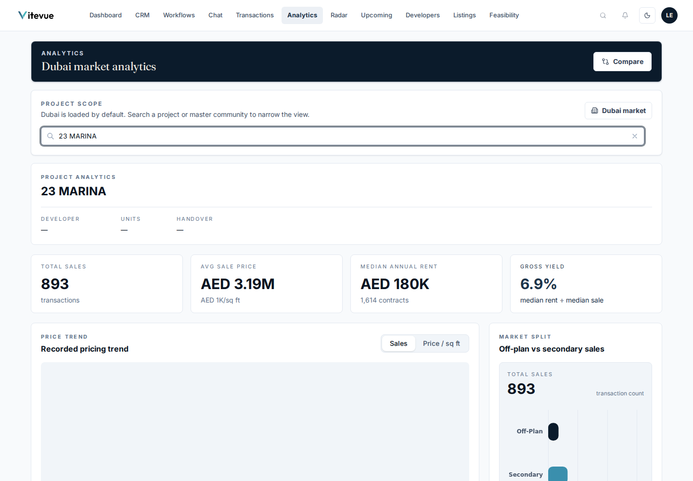
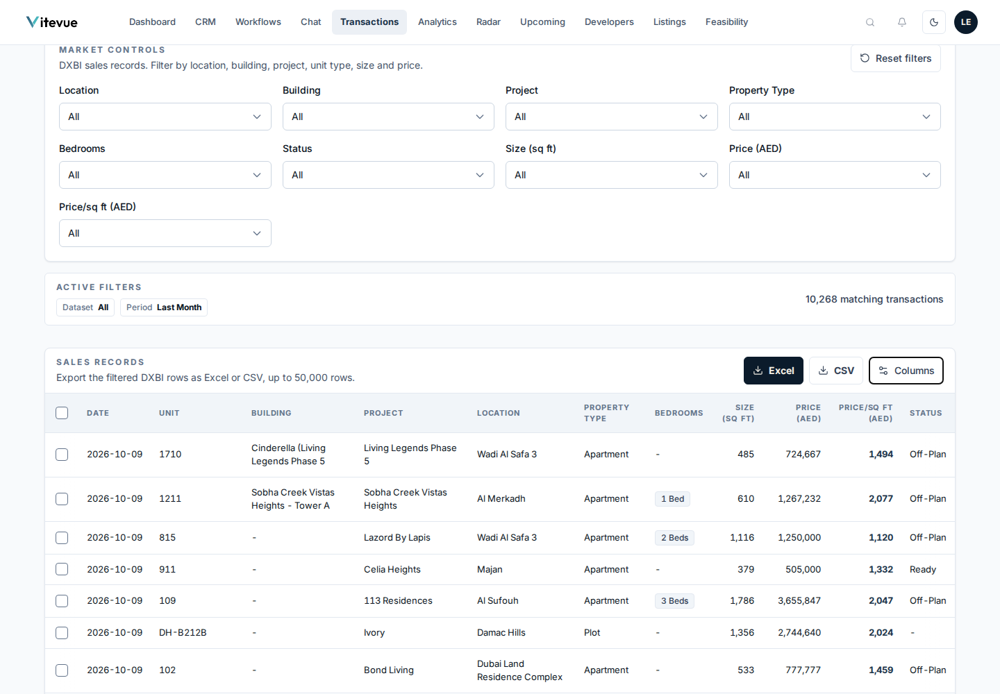

# Transactions and Analytics audit resolution — 10 October 2026

Implementation: [PR #42](https://github.com/Kian-Sham/VV/pull/42), stacked on [PR #41](https://github.com/Kian-Sham/VV/pull/41).

This follow-up resolves the 14 confirmed findings from the [Transactions audit](../transactions-2026-10-10/REPORT.md) and [Analytics audit](../analytics-2026-10-10/REPORT.md). Those reports and their screenshots describe the original defects at `aed5309`; they are historical evidence, not the final state. Implementation proceeded in the order recorded in [PLAN.md](PLAN.md), with focused checks before each next fix.

## Architecture and coverage

Reviewed FastAPI request schemas, authenticated routers, cache namespaces, domain services and ClickHouse queries; DXBI raw-event deduplication and independent pandas reconciliation; XLSX export selection and metadata; generated OpenAPI contracts; Svelte API/query integration, project selection, comparison, chart calculations, transaction tables, filters, pagination, modal focus and keyboard navigation.

Transactions intentionally reads DXBI event tables. Analytics uses `ch_transactions`, `ch_rent_contracts`, `ch_units`, `ch_projects` and developer metadata. Their totals are checked against their respective sources; these datasets are not assumed to have identical coverage. Analytics selection now uses names from those warehouse views rather than display names from the map catalogue.

## Resolved findings in priority order

IDs T1–T6 correspond to Transactions F1–F6; A1–A8 correspond to Analytics F1–F8.

| ID / severity | Confirmed problem and implemented resolution | Main affected files | Executed regression evidence |
|---|---|---|---|
| T1 / P1 | Unnumbered leases in different buildings were discarded. Deduplication requires the same explicit building path and commercial terms; records without building identity are retained. | `backend/app/transaction/queries.py`; independent verifier; Transactions/filter routers | Isolated real ClickHouse tests cover different buildings, legitimate copies and missing identity. |
| T2 / P1 | Sales in same-named towers across areas collapsed. Sale identity includes area and building; missing identity preserves the source key. | Same Transactions query, verifier and router files | Cross-area counterexample and existing scrape/CSV duplicate tests pass. |
| A1 / P1 | Display names selected projects with zero sales. Analytics search returns canonical warehouse names from all four relevant views. | `backend/app/analytics/queries.py`; Analytics route and `ProjectSelector.svelte` | Canonical search integration test; live selection and source/API reconciliation. |
| A2 / P1 | Project stock used the parent community or returned zero. Unit composition uses the same scope predicate as project transactions and rentals. | Analytics queries, service and summary cache namespace | Direct selection and drill-down service regressions; live registered-unit counts match. |
| A3 / P1 | Overdue planned handovers became completed stock. Only recorded actual completion contributes to completed stock; overdue and undated units are reported separately. | Analytics service/models/queries; `ProjectPanel.svelte`; generated contracts | Fixed-date unit regression and independent live pipeline reconciliation. |
| A4 / P2 | Master communities were absent from the map catalogue used for search. Canonical search exposes master and virtual-master scopes. | Analytics search, selector and comparison components | Live master discovery and keyboard drill-down; isolated master search test. |
| A5 / P2 | Current-quarter deliveries disappeared from future stock. Their units now carry into subsequent quarters. | Analytics pipeline service | Quarter-boundary unit regression and live carry reconciliation. |
| A6 / P2 | Bedroom filters displayed proportional estimates as recorded supply. Unsupported bedroom controls and synthetic multiplication were removed; area-wide all-bedroom scope is explicit. | `ProjectPanel.svelte` | Live browser verifies all-bedroom disclosure and absence of unsupported controls. |
| T3 / P2 | Old rows remained actionable under new page/filter labels. Placeholder rows are replaced by loading content and the count is marked as updating. | Sales and rental route pages | Delayed-response browser regressions for both tabs. |
| T4 / P2 | Selected XLSX exports listed filters that had been overridden. Metadata now describes effective selected IDs, or actual filters when IDs are blank. | `backend/app/transaction/exports.py` | Six export tests, including both selection types and blank IDs. |
| T5 / P2 | Facet failures looked like empty filters. Both tabs display failure state and Retry filters. | Sales and rental route pages | Injected 503 and successful retry for both tabs. |
| T6 / P2 | Details dialog lost keyboard focus. Shared modal focuses its content, contains Tab/Shift+Tab, closes with Escape and restores prior focus/body scrolling. | `frontend/src/lib/components/ui/Modal.svelte` | Live dialog focus and keyboard containment regression; existing dismissal checks. |
| A7 / P2 | Failed panels appeared as empty data or incomplete comparison. Errors and retries now cover summary, trends, forecast, distribution, supply, search and development counts. | `AnalyticsError.svelte`, project panel, comparison and selector | Injected outages/recovery for trends, distribution, pipeline, forecast, both comparison endpoints, project search and development lists. |
| A8 / P2 | Search blur and mouse-only subproject buttons blocked keyboard selection. Focus remains within selectors, options activate on click/Enter, arrows move between project results and Escape closes the menu. | Project selector and project panel | Tab/Enter, arrows/Escape and live master drill-down browser regressions. |

Backend and frontend generated contracts are synchronized. Versioned list/facet and summary cache keys prevent pre-fix cached responses from surviving release.

## Verification

Executed results are recorded in [verification-results.txt](verification-results.txt). 353 backend tests, 53 isolated ClickHouse tests and 59 frontend unit tests passed; all 40 browser cases passed across the final relevant suites (18 Analytics, 11 Transactions audit, 11 existing Transactions); Svelte/TypeScript reported zero errors and zero warnings; backend lint and frontend generation/lint passed; the frontend production build succeeded.

The independent Transactions verifier passed **405 checks with zero failures**, reconciling raw DXBI rows against live API rows, counts, filter options and band totals. The last-year snapshot contains 172,940 sales and 879,831 leases after deduplication.

Independent local Analytics reconciliation:

| Project | Sales | Sales value (AED) | Registered-unit rows with bedroom data |
|---|---:|---:|---:|
| 23 MARINA | 893 | 2,848,576,487 | 294 |
| MARINA PINNACLE | 2,262 | 2,591,689,921 | 772 |
| Binghatti Skyrise | 2,907 | 4,561,381,930 | 3,358 |

Direct project selection and selection with a master parameter return the same project composition. At the Dubai business date 2026-10-10, the independent source calculation matches 426,065 completed units, 47,215 overdue units, 62,742 undated units and 41,027 current-quarter scheduled deliveries. Next-quarter carried stock is 467,092 = 426,065 + 41,027.

## Evidence

After-fix screenshots are saved in [screenshots](screenshots/). The baseline audit directories retain before-fix screenshots.



 Private credentials, sessions, raw response snapshots and detailed execution logs remain in ignored `.evaluation`; they are excluded from the PR.

## Remaining limits and release notes

No production data or warehouse schema was changed. Verification uses the authorized local WSL stack and its warehouse snapshot. Production deployment, concurrent-user load, real ingestion/cache-refresh cycles, exhaustive aliases/date boundaries, forecast predictive accuracy, complete physical-stock identity, other browser engines and a full assistive-technology audit remain untested. Shared modal behavior was verified through sale details; every admin modal flow was not individually exercised.

Some canonical projects lack a project-metadata record in the local source: a case-insensitive lookup found no `ch_projects` record for 23 MARINA or MARINA PINNACLE. Their available transactions and registered-unit composition reconcile, while unavailable developer/handover/project-total metadata remains blank. The fix does not invent missing source metadata. Comparison development-count recovery uses the same error/retry pattern but its separate error branch was code-reviewed rather than independently fault-injected.

The build succeeds with existing dependency/PasswordInput unused-import warnings, large-chunk notices and adapter-auto's notice that no deployment platform is detected locally. This PR does not alter the deployment adapter.

The PR is stacked on `fix/analytics-numbers` (PR #41); review/merge its prerequisite before integrating this follow-up into the main development branch. No merge or deployment is included. The unrelated existing edit to `docs/data-pipelines/UNIFORM_LAYER_CHANGES.md` is excluded.


## Reproduction

Run `just test-backend`, `just test-backend-clickhouse`, `just test-frontend`, `just lint-backend`, `just lint-frontend`, `just check-frontend`, `just generate-client` and `just build-frontend` from the repository root with the documented host prerequisites. ClickHouse tests provision and remove their own isolated local databases.

Browser checks reuse an existing authorized test session and running local stack. With that session saved securely at `e2e/.auth/user.json`, run from `e2e`:

```sh
bunx playwright test --project=chromium --no-deps --workers=1 --retries=0 --timeout=120000 analytics-audit.spec.ts transactions-audit.spec.ts transactions.spec.ts
```

This audit used equivalent temporary configuration with an ignored storage-state path, viewport 1440×1000, Chromium, one worker, no retries and tracing disabled. The existing account-provisioning setup was bypassed. Screenshots are saved by the tests in the resolution directory. The independent source verifier is `backend/scripts/clickhouse/verify_dxbi_transactions.py`; obtain its bearer token through secure local authentication and supply it through `VERIFY_API_TOKEN`, never a committed file.
